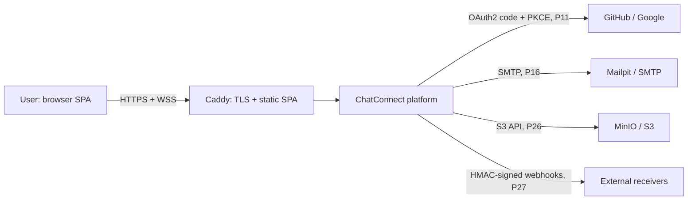
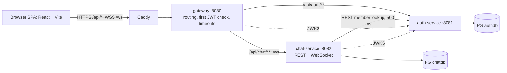
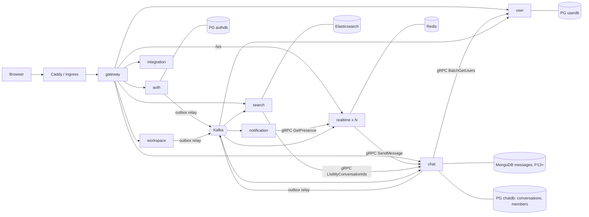
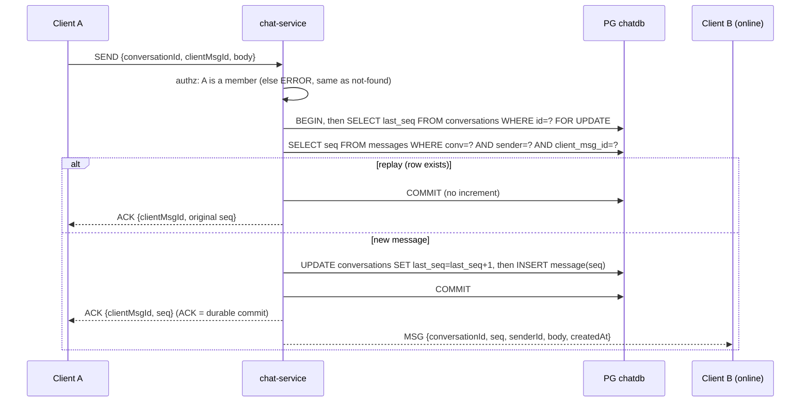
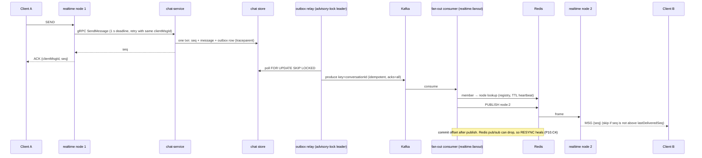

# ChatConnect — System Architecture (living document)

Status: foundation draft, 2026-11-27, written before P1. Items marked **[gate]** are proposals only. They get decided at the IRREVERSIBLE checkpoint named, with an ADR and APPROVE (MP §5). All numbers here are **targets or estimates**, not measurements (I15). Measurements belong in `docs/perf/`.

---

## 1. Problem, quality attributes, non-goals

**V1 functional scope:** register/login, 1:1 and group conversations, real-time send/receive, history, unread counts, reconnect without loss or duplicates.

**Quality attributes, ranked.** Higher ranks win trade-offs:

| Rank | Attribute | Concrete target (to be measured) | Enforced by |
|---|---|---|---|
| 1 | Ordering + delivery correctness | 0 lost, 0 duplicated, 0 reordered messages under retries, reconnects, node kill | I1–I5, P3.C5, P10.C4 |
| 2 | Security | Every hop authenticates; owner authorizes per resource | I13, §6 Security |
| 3 | Operability | Every checkpoint green and resumable; one traceId across all hops | I10, I12 |
| 4 | Latency | send→ACK p95 ≤ 150 ms, send→deliver p95 ≤ 250 ms on the V1 VM (**target**) | P6.C3 k6 |
| 5 | Horizontal scale | Stateless HTTP from V1; WS nodes scale-out from V2 | P10 |
| 6 | Cost | Runs on one small VM through V3 | P6.C1 |

**Non-goals (V1–V5):** E2EE, multi-region, more than ~1k-member fan-out, mobile, edits/reactions. These are all in the V6 backlog.

---

## 2. System context (C4 level 1)

---

## 3. Container views

### 3.1 V1 (P1–P6): 3 services + PostgreSQL

V1 debt by design: one chat-service replica owns all WS sessions in memory, so `/ws` can't scale out. This is fixed at P10 (ADR-009/015).

### 3.2 Target (V5)

---

## 4. Service responsibilities and data ownership (I7)

| Service | Writes (owns) | Store | Exposes | Consumes | From |
|---|---|---|---|---|---|
| gateway | nothing (rate-limit keys `gw:*` from P15) | — / Redis | routes, CORS, JWT check #1, rate limit | — | P1 |
| auth | credentials, roles, refresh tokens, OAuth links, signing keys | PG authdb | `/api/auth/v1/*`, JWKS | — | P1 |
| chat | conversations, members, messages, seq counters, outbox, receipts | PG chatdb (messages → Mongo P13) | `/api/chat/v1/*`, WS (P4–P9), gRPC chat.v1 | workspace.*.v1 (P25) | P1 |
| user | profiles | PG userdb | profile REST, gRPC user.v1 | user.registered.v1 | P9 |
| realtime | WS sessions, user→node registry, presence, typing | Redis `rt:*` | `/ws`, gRPC GetPresence | chat.message.created.v1, chat.receipt.updated.v1 | P10 |
| search | message index | ES `messages-*` | search REST | chat.message.created.v1 | P14 |
| notification | digests, processed_events | PG notifdb (assumed) | admin DLT replay | chat.message.created.v1 | P16 |
| workspace | workspaces, channels, roles, invites | PG workspacedb | REST | — | P25 |
| integration | webhook endpoints, bot tokens, deliveries | PG integrationdb (assumed) | REST | message events | P27 |

**Rule:** if a service needs another service's data, it calls an API or keeps an event-fed projection of its own (P25.C3 pattern). It never reads the other service's store.

---

## 5. Interaction map

### 5.1 Sync edges and deadline budget

**Deadline nesting rule:** a caller's timeout must be greater than the callee deadline × attempts, plus backoff. Without that, retries outlive the caller, and the work is wasted or, worse, duplicated.

| Edge | Protocol | From | Deadline (proposal) | Retry | Why it's safe to retry |
|---|---|---|---|---|---|
| browser → gateway | HTTPS | P1 | client 10 s | single-flight refresh only | — |
| gateway → services | HTTP | P1.C3 | connect 1 s, response 5 s; `/ws` exempt | none at gateway | POSTs aren't idempotent at the HTTP level |
| chat → auth member lookup | REST | P3.C2 | 500 ms | GET, ≤2, exp backoff + jitter | read-only |
| chat → user BatchGetUsers | gRPC | P9.C3 | 300 ms | ≤2 | read-only |
| realtime → chat SendMessage | gRPC | P10.C2 | 1 s | ≤2, same clientMsgId | I1 makes it a replay |
| search → chat ListMyConversationIds | gRPC | P14.C3 | 300 ms, cached | ≤2 | read-only |
| notification → realtime GetPresence | gRPC | P16.C1 | 200 ms | ≤1 | read-only |
| service → own PG | JDBC | P2 | pool acquire 2 s, `statement_timeout` 5 s | none (txn) | — |

Example for V1: Axios 10 s > gateway 5 s > chat→auth with 3 attempts ≈ 1.5 s + backoff. The budgets nest.

### 5.2 Async topics (proposal; P8.C1 is the gate)

| Topic | Key | Partitions | Producer | Consumer groups | From |
|---|---|---|---|---|---|
| chat.message.created.v1 | conversationId | 6 | chat (outbox) | realtime.fanout, search.indexer, notification.digest, chat.mongo-shadow | P8 |
| chat.receipt.updated.v1 | conversationId | 6 | chat (outbox) | realtime.fanout | P11 |
| user.registered.v1 | userId | TBD at P9 | auth (outbox) | user.profile-create | P9 |
| workspace.*.v1 | workspaceId | TBD at P25 | workspace (outbox) | chat.permission-projection | P25 |
| **chat.member.changed.v1 (gap)** | conversationId | 6 | chat (outbox) | realtime/search membership caches | add at P10 or P14 |

The last row is missing from the MP. P14.C3 (search's membership cache), P15.C2 ("evict on write + event"), and the realtime fan-out member cache all need a membership-change event. Adding a topic is add-only (I9), so it needs a topic-as-code entry, not a roadmap ADR.

---

## 6. Core flows

### 6.1 Send, V1 (P3.C3 + P4.C2)

### 6.2 Seq + idempotency: the pinned algorithm (input to the P3.C1/C3 gate)

Gapless I2 means **an increment is never committed without its message row**. Here is the trap that breaks it:

- **Wrong:** `UPDATE … last_seq+1` followed by `INSERT … ON CONFLICT DO NOTHING`. On a replay the insert is skipped but the increment commits, which leaves a permanent gap.
- **Option A (lock first, recommended for PG):** `SELECT … FOR UPDATE` on the conversation row, then the existence check, then increment and insert, all under the lock. Replays serialize behind the lock, there's no exception-driven control flow, and the code is easy to test. Cost: one extra indexed lookup while holding the lock.
- **Option B (optimistic):** increment and insert directly. If the unique constraint is violated, the whole txn rolls back (the increment too, so no gap), and a fresh txn reads the original. The common path is one statement shorter. The race path relies on exceptions. This is the natural shape for Mongo at P13 ($inc plus a unique index plus a retry).
- **Ceiling (estimate):** every send to one conversation serializes on one row lock, so per-conversation throughput ≈ 1 / lock-hold-time, which is dominated by commit fsync. Across conversations it parallelizes. P3.C5 measures this; it isn't a claim.
- **Payoff:** unread = `last_seq − last_read_seq` is exact and O(1), because seq has no gaps. If P27 soft-delete counts deleted messages as unread, decide that at P27.

### 6.3 Reconnect and resync (P4.C3, P5.C3)

1. For each conversation, the client keeps `lastSeq`, the highest *contiguous* seq it has rendered.
2. On reconnect it sends `AUTH`, then `RESYNC{conversationId, lastSeq}` for each open conversation. The server replays `seq > lastSeq`, bounded, then switches to live. Gaps bigger than the bound fall back to REST keyset history.
3. Live frames that arrive out of order are buffered. If a gap persists past a timeout, the client sends another `RESYNC`. Dedupe is on `(conversationId, seq)`.
4. Reconnect backoff is exponential with full jitter, capped at 30 s. This avoids a thundering herd after a node restart.

### 6.4 Auth (P2, P4.C1)

- Login returns an access JWT (RS256, 15 min, `kid`) that the SPA keeps **in memory**. It also sets a refresh cookie: opaque, 256-bit, stored as a SHA-256 hash, httpOnly, Secure, SameSite=Strict, Path=`/api/auth/v1/refresh`.
- A 401 triggers one **single-flight** refresh, and the refresh token rotates on every use.
- WS: the first frame is `AUTH{jwt}` within 5 s, otherwise the server closes with 4401. `REAUTH` is sent before `exp`. No tokens go in URLs.
- In dev, the Vite proxy forwards `/api` and `/ws` to the gateway, so dev is same-origin like prod (one Caddy origin) and the cookie and CORS behave identically.

### 6.5 Send, V2+ (P8–P10)

---

## 7. Invariant → mechanism → proof

| ID | Mechanism | Proven by |
|---|---|---|
| I1 | unique `(conversation_id, sender_id, client_msg_id)` + lock-first send | P3.C3, P10.C2 |
| I2 | row-locked counter in the send txn; seq is the only sort key in DB, client and consumers | P3.C5, P10.C4 |
| I3 | producer key = conversationId; partition counts fixed as code | P8.C1 |
| I4 | natural-key upsert `(conv, seq)` or processed_events in the effect txn | P8.C3, P13.C2, P14.C2, P16.C2 |
| I5 | outbox row in the domain txn incl. traceparent; single active relay | P8.C2, P20.C1 |
| I6 | wording rule in docs and bullets | REVIEW, BULLETS |
| I7 | DB + credentials per service; cross-service reads only via API/projection | REVIEW, compose config |
| I8 | events + compensation, no XA | design rule, REVIEW |
| I9 | `/v1` paths, add-only fields, contract tests, `buf breaking` | P8.C1, P9.C4 |
| I10 | probes, ECS logs, traceId, graceful shutdown from first commit | P1.C2 |
| I11 | gitleaks in CI | P1.C5 |
| I12 | `./mvnw verify`, `npm test`, `docker compose up` every checkpoint | every AT |
| I13 | every service is a JWKS resource server; authz at the owner | P2.C5, P3.C2 |
| I14 | nested deadlines (§5.1); retries only for idempotent ops | P7.C3, P20.C2 |
| I15 | `docs/perf` rows carry command + env + date | P6.C3 onward |
| I16 | stack-line changes only via ADR | ADR-002 |

---

## 8. Cross-cutting conventions (proposals; each locks at the checkpoint named)

| Concern | Proposal | Locks at |
|---|---|---|
| URL scheme | `/api/{service}/v{n}/{resource}`; the gateway routes on `/api/{service}/**`, so a version bump needs no gateway change | P1.C3 |
| IDs | server-generated UUIDv7 for entities; client UUIDv7 `clientMsgId` (validate version nibble); never order by UUID time | P3.C1 [gate] |
| Errors | RFC 7807 ProblemDetail, `type` = `urn:chatconnect:problem:<slug>`, extra `traceId`; non-member and unknown resource both return 404 | P2.C2 |
| Pagination | message keyset `beforeSeq` + `limit ≤ 100`; lists use an opaque cursor; never OFFSET | P3.C4 |
| Time | server UTC `Instant`, ISO-8601 on the wire; client time is never trusted for ordering | P3.C1 |
| Persistence | Spring `JdbcClient` + Flyway (explicit SQL for row locks, `RETURNING`, keyset). Trade-off: more hand-written SQL, but no ORM surprises on the hot path | P2.C1 (ADR) |
| Gateway flavour | reactive Spring Cloud Gateway (WebFlux) because P4 proxies WebSockets; verify artifact coordinates for the chosen release train | P1.C1/C3 |
| Logging | Boot built-in structured logging (`logging.structured.format.console=ecs`); no extra encoder; never log tokens or message bodies | P1.C2 |
| Tests | `*Test` = unit (surefire); `*IT` = Testcontainers integration (failsafe, singleton containers); `./mvnw verify` runs both; compose smoke from P1.C4; k6 from P6 | P1.C1 |
| Config/secrets | env vars + mounted files (JWT private key); `.env` never committed; gitleaks gate | P1.C5, P2.C3 |
| Line endings | `.gitattributes` forces LF (`mvnw` breaks with CRLF), with CRLF only for `*.cmd`/`*.bat` | now |

---

## 9. Deployment topology

| Stage | Where | Orchestration | Notes |
|---|---|---|---|
| Local | Docker Desktop engine (D2); toolchain on Windows or WSL per D4 | Compose profiles `core` / `events` / `data` / `obs` | the service under work runs from IntelliJ; core + at most 2 heavy profiles |
| V1–V3 | one cloud VM | Compose + Caddy | provider chosen at P6.C1 after checking current limits online |
| V4+ | same VM | k3s + Kustomize | datastores stay in Compose locally (ADR-020) |

Local resource envelope: WSL capped at 10 GB RAM and 4 GB swap (`.wslconfig`). Track actual per-container usage with `docker stats`, recorded in PROJECT_STATE. Disk: images for Kafka, ES, Mongo, the observability stack and about 10 service images will run to tens of GB, so the WSL disk must live on a drive with headroom (see PROJECT_STATE environment section).

---

## 10. Irreversible decision register

| Gate | Decision | Options | Leaning (not decided) |
|---|---|---|---|
| P3.C1 | Message identity + seq semantics | (a) PK `(conversation_id, seq)`; (b) surrogate UUID PK + unique `(conversation_id, seq)` | (a): keyset history reads one index range; maps 1:1 to the Mongo unique index (P13) and the ES doc id `conv:seq` (P14); P26 thread parents are already `(conv, seq)` |
| P3.C1 | Counter location | (a) `conversations.last_seq`; (b) separate counter table | (a): one row lock, and the same row carries the conversation-list sort key |
| P4.C2 | Frame protocol v1 | (a) `type` field only; (b) subprotocol `chatconnect.v1` negotiated at handshake + `type` | (b): the version is negotiated before any frame, and v2 can coexist |
| P8.C1 | Envelope, topic names, partitions | JSON + contract tests (MP) vs Avro + registry (V6) | JSON per MP §6 |
| P13.C5 | Store cutover | per MP | — |
| P1.C1 (not a gate, but expensive) | Spring Boot line | 3.5.16 vs 4.x | **decided: 3.5.16, stay on 3.x** (recorded in ADR-002) |

---

## 11. Top risks

| ID | Risk | Mitigation | Owner/when |
|---|---|---|---|
| R1 | **Spring Boot 3.5 and Spring Cloud 2025.0 are past OSS end of life** (2026-06-30; last OSS releases 3.5.16 / 2025.0.3). No free CVE patches, so Trivy (P21.C3) can redden CI | **Decided: stay on 3.5.16 / 3.x.** Override managed dependency versions in the parent BOM when fixes exist; Trivy exceptions only with a reason and expiry (DEBT-1) | ADR-002 at P1.C1 |
| R2 | The hot-conversation ceiling is inherent to gapless seq | measure at P3.C5; document; V6 large-group redesign | P3.C5 |
| R3 | Missing membership-change event (§5.2) | add `chat.member.changed.v1` | P10/P14 |
| R4 | Single WS node (V1), single relay (V2) | accepted debt, logged in PROJECT_STATE | P10, P8 |
| R5 | Laptop RAM/disk | profiles, mem limits, WSL disk on a roomy drive | ongoing |
| R6 | Scope: 98 checkpoints solo | every release tag is a complete portfolio state; V1 + V2 already make a strong story | each release |
| R7 | AI-agent API drift on newer framework versions | compile/test loop, read release notes/docs before new APIs, pin versions | every checkpoint |
